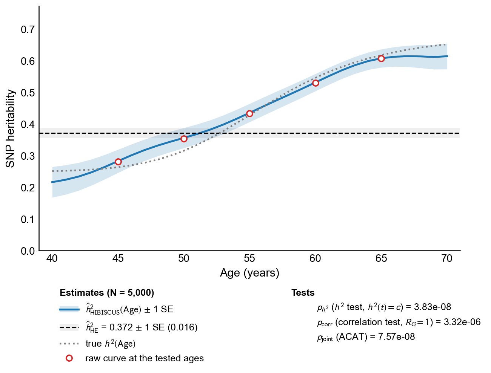
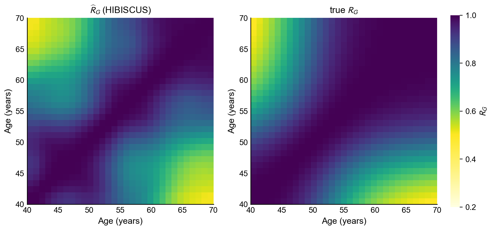

# HIBISCUS

HIBISCUS estimates how SNP heritability changes with age. From genotypes, one quantitative phenotype
and the age at which it was measured, it estimates the age-varying SNP heritability h²(t) and the
genetic-correlation surface R_G(t₁, t₂) between ages, with standard errors, by kernel-weighted
Haseman–Elston regression on a sparse genomic-relationship (GRM) edge set. It then tests two
hypotheses: the **h² test** (H₀: h²(t) is constant over age) and the **correlation test**
(H₀: R_G(t₁, t₂) = 1 for all ages, i.e. the same genetic effects act at every age), and combines
them into a joint p-value, **p_joint = ACAT(p_h2, p_corr)**. The package is pure Python (numpy, scipy,
pandas, matplotlib); the toy example below runs in about two minutes on a laptop.

## Table of contents
* [Installation](#hammer-installation)
* [Step 1: Prepare the input files](#dna-step-1-prepare-the-input-files)
* [Step 2: Build the GRM and the sparse edge set](#scroll-step-2-build-the-grm-and-the-sparse-edge-set)
* [Step 3: Estimate h2(t) and R_G(t1, t2)](#rocket-step-3-estimate-h2t-and-r_gt1-t2)
* [Step 4: Standard errors](#bar_chart-step-4-standard-errors)
* [Step 5: Tests of age variation](#mag-step-5-tests-of-age-variation)
* [Step 6: Figures](#framed_picture-step-6-figures)
* [Output](#bulb-output)
* [A toy example](#key-a-toy-example)
* [Maintainer](#busts_in_silhouette-maintainer)
* [References](#references)

## :hammer: Installation

HIBISCUS requires Python >= 3.10 with `numpy`, `scipy`, `pandas` and `matplotlib`. No R, PLINK
or compiled code is needed (PLINK 2 can optionally build the GRM in Step 2).

```
git clone https://github.com/shuangsong0110/HIBISCUS.git
cd HIBISCUS
pip install -r requirements.txt
```

`pip install -e .` additionally makes `import hibiscus` available outside the checkout; the
scripts below run either way.

The analysis is six scripts in `scripts/`, run in order. `run_pipeline.sh` runs all six and passes
every argument on to each of them:

```
bash run_pipeline.sh                                                        # the toy example, into example/
bash run_pipeline.sh --workdir mywork --dataset mytrait --test-range 45 65  # your own data
```

Every script accepts `--workdir DIR` (the root of `data/ grm/ results/ figures/ summary/`; default
`example/`), `--dataset NAME` (the trait name; default `toy_dynamic`), `--test-range T_MIN T_MAX`
(the ages on which the tests are run, see Step 5) and `--force` (recompute outputs that already
exist). Every script also accepts `--phenotype-tsv`, `--sample-ids-csv`, `--plink-prefix`,
`--edges-npz`, `--edges-json`, `--random-scores-npy` and `--genetic-scores-npy` to point at your
own files instead of the default locations `<workdir>/data/<name>/` and `<workdir>/grm/<name>/`.

## :dna: Step 1: Prepare the input files

#### Script: [`scripts/01_prepare_data.py`](scripts/01_prepare_data.py)

HIBISCUS reads three files from `<workdir>/data/<name>/`.

| File | Format |
|---|---|
| `phenotype.tsv` | Tab-separated with a header. Columns `FID`, `IID`, `y` (the phenotype) and `t` (the age at which `y` was measured); other columns are ignored. One row per visit: rows with a missing `y` or `t` are dropped, then the **first remaining row per `IID`** is kept. |
| `sample_ids.csv` | Comma-separated with a header `FID,IID`: the genotyped subjects **in the order of the `.fam` file**. Row *i* is subject *i* in the GRM, the edge set and the score files. |
| `geno.bed`, `geno.bim`, `geno.fam` | PLINK 1 binary genotypes. Missing genotypes are set to the SNP mean. |

Synthetic example rows:

```
FID	IID	y	t
1	1	0.4817	58.3
2	2	-1.2203	44.9
3	3	0.0652	61.0
```

```
FID,IID
1,1
2,2
3,3
```

**Adjust the phenotype for covariates before running HIBISCUS**: regress `y` on an intercept, age, age²,
sex and the top genetic PCs (plus any batch covariates), and use the residuals as `y`. HIBISCUS itself
only centres and standardises `y` internally, so no result depends on its unit; variances are written
back in the original units.

Subjects are matched to the genotypes by `IID`. This step checks the three files:

```
python scripts/01_prepare_data.py --workdir mywork --dataset mytrait
```

For the two toy datasets (`toy_dynamic`, `toy_null`) it simulates the files when they are absent.

## :scroll: Step 2: Build the GRM and the sparse edge set

#### Script: [`scripts/02_build_grm.py`](scripts/02_build_grm.py)

```
python scripts/02_build_grm.py --workdir mywork --dataset mytrait
```

- The GRM is K = Z Zᵀ / M with Z the column-standardised genotypes (`--plink2 /path/to/plink2
  [--threads 8]` uses `plink2 --make-rel square0 bin4` instead).
- For every subject i the GRM entries K_ij with j > i are sorted by K²_ij and kept until 99.5% of
  their Σ K²_ij is covered or 1,024 entries are reached, whichever comes first. Each pair is stored
  once in `grm/<name>/edges.npz` (`row < col`, `kij`) with `edges.json`.
- Two auxiliary files are drawn from the genotypes: rank-256 randomised GRM scores
  (`random_scores.npy`, used by the correlation test) and a bank of 800 genetic scores
  (`genetic_scores.npy`, used by the h² test).

Run this step **once per cohort**: all traits measured on the same genotyped subjects share the
GRM, the edges and the score files (see [Your own data](#your-own-data) for the flags that point
later steps at them). The GRM is built as a dense N × N matrix and the script holds a few copies of
it while selecting the edges, about 24 N² bytes at peak (0.6 GB at N = 5,000, 60 GB at N = 50,000);
Steps 3–6 only touch the stored edges.

#### Output: `grm/<name>/edges.npz`, `edges.json`, `random_scores.npy`, `genetic_scores.npy` and their `*_meta.json`

## :rocket: Step 3: Estimate h2(t) and R_G(t1, t2)

#### Script: [`scripts/03_estimate.py`](scripts/03_estimate.py)

```
python scripts/03_estimate.py --workdir mywork --dataset mytrait
```

#### Output: `results/<name>/curves.csv`, `surfaces.csv`, `fit_manifest.json`

`curves.csv` has one row per grid age t (every integer age from the youngest to the oldest subject) and
method:
- `method`: `hibiscus`, the age-varying estimate, or `he`, the age-independent Haseman–Elston estimate
  (constant over t);
- `sigma_g2`: genetic variance σ²_g(t); `sigma_eps2`: residual variance σ²_ε(t) = σ²_y(t) − σ²_g(t);
  `sigma_y2`: phenotypic variance σ²_y(t);
- `h2`: SNP heritability h²(t) = σ²_g(t) / σ²_y(t).

`surfaces.csv` has one row per pair of grid ages (t₁, t₂):
- `cov`: genetic covariance C_g(t₁, t₂);
- `corr`: genetic correlation R_G(t₁, t₂) = C_g(t₁, t₂) / √(C_g(t₁, t₁) C_g(t₂, t₂)).

Variances and covariances are in the units of `y`². `fit_manifest.json` records the grid and the
settings of the fit.

## :bar_chart: Step 4: Standard errors

#### Script: [`scripts/04_se.py`](scripts/04_se.py)

```
python scripts/04_se.py --workdir mywork --dataset mytrait
```

#### Output: three columns added to every row of `results/<name>/curves.csv`: `h2_se_conditional`, the standard error of `h2`, and `h2_ci_lower_conditional`, `h2_ci_upper_conditional`, the ± 1.96 SE interval clipped to [0, 1]. The figure of Step 6 draws the ± 1 SE band.

## :mag: Step 5: Tests of age variation

#### Script: [`scripts/05_tests.py`](scripts/05_tests.py)

```
python scripts/05_tests.py --workdir mywork --dataset mytrait --test-range 45 65
```

Both tests run on the test age range `--test-range T_MIN T_MAX`. By default it is the observed age
range shrunk by 5 years at each end (the toy's ages 40–70 give 45–65), which keeps the tests away
from the boundary of the kernel estimate; give integer ages inside the grid.

### Step 5.1: The h² test

H₀: h²(t) = c for some constant c, i.e. SNP heritability does not change over the test range.

### Step 5.2: The correlation test

H₀: R_G(t₁, t₂) = 1 for all pairs of ages in the test range, i.e. the same genetic effects act at
every age.

### Step 5.3: The joint test

`p_joint = ACAT(p_h2, p_corr)`, the equal-weight Cauchy combination of the two p-values
(Liu & Xie 2020).

#### Output: `results/<name>/tests.csv` (`p_h2`, `p_corr`, `p_joint`)

The script finally rebuilds `summary/all_traits.csv`: one row per trait directory under
`results/` that holds `tests.csv`, with N, the number of edges, ĥ²_HE ± SE, ĥ²(t) ± SE at the
tested ages, the minimum off-diagonal R̂_G and the three p-values. With several traits on one
cohort, run Step 2 once and Steps 3–6 per trait (see [Your own data](#your-own-data)); the summary
then covers all of them.

## :framed_picture: Step 6: Figures

#### Script: [`scripts/06_figures.py`](scripts/06_figures.py)

```
python scripts/06_figures.py --workdir mywork --dataset mytrait
```

- `h2_curve.pdf/.png`: ĥ²(t) with its ± 1 SE band, the HE reference (dashed, ± 1 SE) and the three
  p-values in the legend.
- `corr_heatmap.pdf/.png`: R̂_G(t₁, t₂).

The simulation truth is drawn only when `data/<name>/truth_*.csv` exist (`--no-truth` omits it).
Each figure comes with a `*_data.csv` holding every plotted value.

#### Output: `figures/<name>/h2_curve.{pdf,png}`, `h2_curve_data.csv`, `corr_heatmap.{pdf,png}`, `corr_heatmap_data.csv`

## :bulb: Output

Variance columns (`sigma_g2`, `sigma_eps2`, `sigma_y2`, `cov`) are in the units of `y`²; every
other quantity is unit-free.

| File | Columns |
|---|---|
| `results/<name>/curves.csv` | `t`, `method` (`hibiscus`: the age-varying estimate, one row per grid age; `he`: the age-independent HE estimate, constant over `t`), `sigma_g2`, `sigma_eps2`, `sigma_y2`, `h2`, `h2_se_conditional`, `h2_ci_lower_conditional`, `h2_ci_upper_conditional` |
| `results/<name>/surfaces.csv` | `t_row`, `t_col`, `cov` (C_g) and `corr` (R_G) for every pair of grid ages |
| `results/<name>/tests.csv` | `phenotype_key`, `p_h2`, `p_corr`, `p_joint` |
| `summary/all_traits.csv` | `phenotype_key`, `n_subjects`, `edge_count`, `h2_he`, `se_he`, `h2_<age>`, `se_<age>` at the tested ages, `min_offdiag_corr`, `p_h2`, `p_corr`, `p_joint` |

## :key: A toy example

The repository ships a simulated dataset in `example/data/toy_dynamic/` (N = 5,000 subjects,
M = 1,000 SNPs, one visit per subject at ages 40–70) whose true h²(t) rises from 0.25 at age 40 to
0.65 at age 70 with R_G(40, 70) = 0.50. The files are in exactly the input format of Step 1.

```
bash run_pipeline.sh                           # steps 1-6 on example/data/toy_dynamic, about 2 minutes
bash run_pipeline.sh --dataset toy_null        # the same on a simulated null: h2 = 0.40 at every age
python tests/run_tests.py                      # 22 unit tests (plain asserts, no pytest needed)
```

`PYTHON_BIN=/path/to/python bash run_pipeline.sh` selects the interpreter and `--force` recomputes
everything. Results are written under `example/`; reference outputs of both datasets are in
`example/expected/`.

| Quantity | `toy_dynamic` (h² 0.25 → 0.65) | `toy_null` (h² ≡ 0.40) |
|---|---|---|
| ĥ²_HE ± SE | 0.372 ± 0.016 | 0.407 ± 0.016 |
| ĥ²(45) / ĥ²(55) / ĥ²(65) ± SE | 0.283 ± 0.037 / 0.436 ± 0.029 / 0.608 ± 0.029 | 0.393 ± 0.030 / 0.446 ± 0.028 / 0.421 ± 0.036 |
| `p_h2` | 3.8 × 10⁻⁸ | 0.62 |
| `p_corr` | 3.5 × 10⁻⁶ | 0.65 |
| `p_joint` | 7.6 × 10⁻⁸ | 0.64 |
| min off-diagonal R̂_G | 0.51 (truth 0.50) | 0.88 (truth 1) |

<p align="center">

</p>
<p align="center">

</p>

### Your own data

Put `phenotype.tsv`, `sample_ids.csv` and `geno.bed/.bim/.fam` in `mywork/data/mytrait/` and run

```
bash run_pipeline.sh --workdir mywork --dataset mytrait --test-range 45 65
```

or the six scripts one by one with the same arguments. Several traits on one cohort: run Step 2 once
with `--dataset cohort`, then Steps 3–6 per trait with `--dataset <trait>` and the shared files passed
explicitly, e.g. `--edges-npz mywork/grm/cohort/edges.npz --edges-json mywork/grm/cohort/edges.json
--random-scores-npy mywork/grm/cohort/random_scores.npy --genetic-scores-npy mywork/grm/cohort/genetic_scores.npy`
(and `--plink-prefix`, `--sample-ids-csv` for the cohort's genotype files).

## :busts_in_silhouette: Maintainer

Please contact Shuang Song (shuangsong@hsph.harvard.edu) if there are any problems or questions.

## References

* Haseman JK, Elston RC (1972). The investigation of linkage between a quantitative trait and a marker locus. *Behavior Genetics* 2, 3–19.
* Fan J, Gijbels I (1996). *Local Polynomial Modelling and Its Applications*. Chapman & Hall.
* Imhof JP (1961). Computing the distribution of quadratic forms in normal variables. *Biometrika* 48, 419–426.
* Liu Y, Xie J (2020). Cauchy combination test: a powerful test with analytic p-value calculation under arbitrary dependency structures. *Journal of the American Statistical Association* 115, 393–402.
